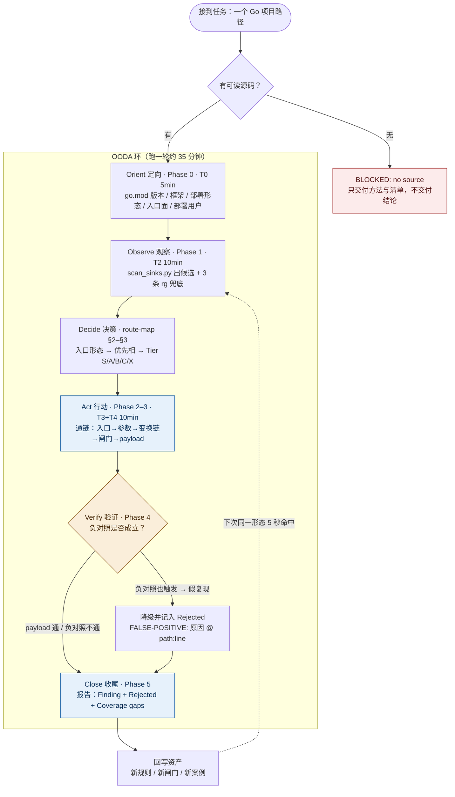
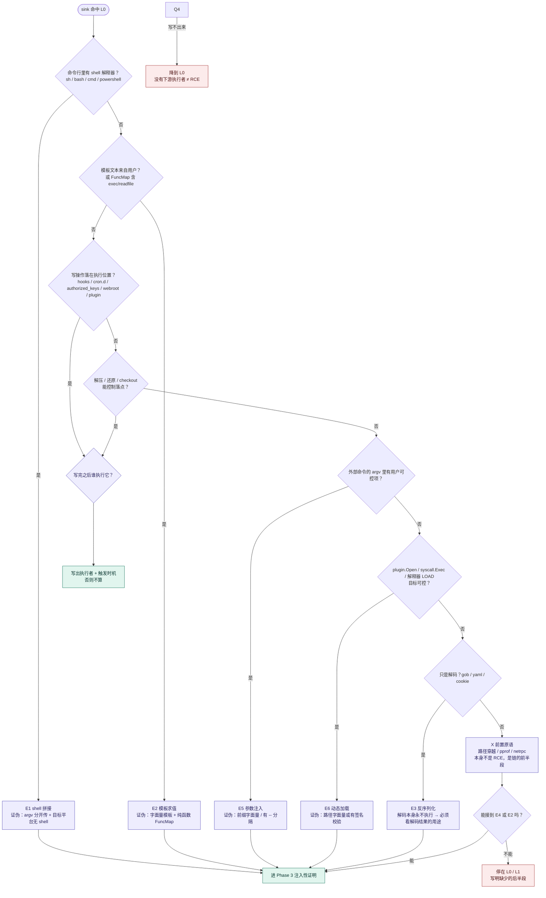
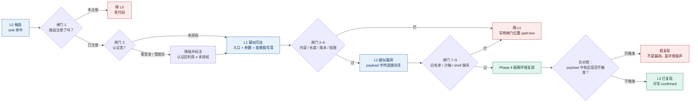
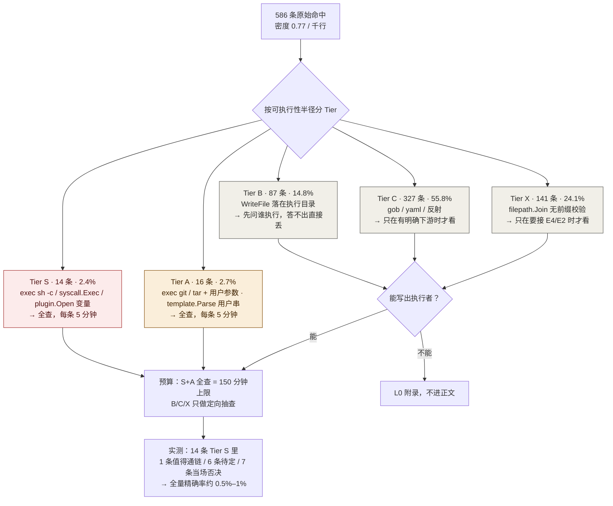
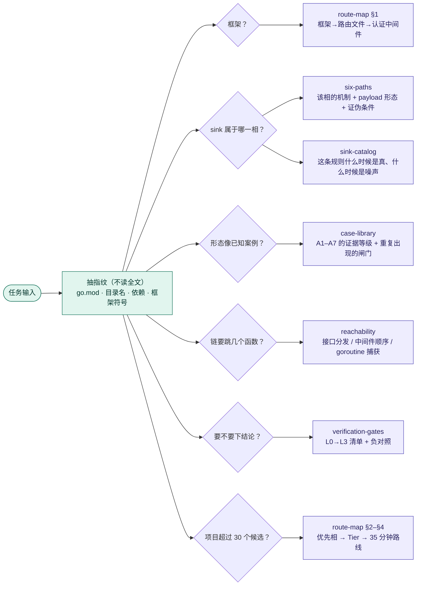
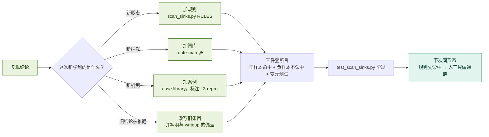

# 执行流程全图（mermaid）

本文件是 `SKILL.md` 的**图形化等价物**。文字版看 SKILL.md，想知道"这一步为什么排在这里"看本文件。

所有图都是 mermaid 源码，可直接粘进支持 mermaid 的渲染器（GitHub、Typora、VS Code、飞书文档）。
图中的 `E1–E6 / X` 是六相编号，`L0–L3` 是证据等级，`T0–T4` 是时间预算槽位，与
[route map](route-map.md) §4 的三十五分钟路线一一对应。

---

## 图 1 — 总流程：OODA 六步 × Phase 0–5

一条任务从进来到出报告只走一遍这条线。**虚线是回写**，它让下一次跑得更快。

**读法**：`Orient → Observe` 之间**不能跳**。跳过定向直接扫，会出现 route-map §0 记录的那种事故——
Gitea 1.4.0 的 LFS handler 全都写在源码里，但 git 版本不够时 `LFS.StartServer = false`，
路由根本不注册，所有请求 404，白猜三轮。

---

## 图 2 — 判定树：一条 sink 命中该走哪一相

扫描器只回答"这里有危险调用"，本图回答"它属于哪一相、用什么标准证伪"。
**这是全流程里唯一必须逐条走完的分支**，走错相会导致整条链的分析结论作废。

**这张图存在的理由**：`exec.Command` 不等于 E1。只有 shell 会把字符串变成命令行。
`exec.Command("cat", "/reports/"+name)` 是路径穿越，报成 RCE 会被一分钟打回。
反过来，Gitea 2026 的在野 RCE 全程没有 `exec`——它写了个 git hook，是纯 E4。

---

## 图 3 — 证据门：L0→L3 与九道闸门的拦截位置

九个闸门不是"注意事项"，它们是**流水线上的拦截器**。每撞上一个，等级必须当场降下来。

九道闸门的识别方法见 [route map](route-map.md) §5。实测数据说明为什么这张图重要：
Gitea 1.4.0 那条链在 L2 看着完美——未授权、参数直达、payload 字符全存活，
但闸门 3（内容闸门：先写 `.tmp` 再比对 `sha256(content)==oid`）把写侧彻底封死，
最终只能定级为"未授权任意文件读 + 任意目录创建"，**不是 RCE**。

---

## 图 4 — 候选排序：25 条规则 → 5 个 Tier → 通链预算

扫描器输出 25 条规则的命中，本图是**把它们压成可执行的预算分配**。
校准数据来自 10 个真实项目 / 760k LOC / 586 命中。

**核心结论**：命中数最多的三条规则（E2 模板 40%、X 路径 22%、E6 反射 15%）
恰好是最不可直接利用的三条。**按命中数排序 = 按噪声排序**，
所以 route-map 用 Tier 而不用 `--min-severity` 排序。

> **数值时效**：图中的 586 / 14 / 16 是 2026-11-13 首轮规则下的标定。同日盲测发现
> `E2-TPL-USERSTRING` 与 `E4-ZIPSLIP` 各有一处形变错误（详见
> `sink-catalog.md` 对应条的"历史噪声"），修正后四个项目合计减少 81 条 Tier A/B 命中。
> 结论方向不变（S+A 占比极低），但**具体条数需按当轮规则重跑，不要引用旧数**。

---

## 图 5 — RAG 唤醒：从任务输入到加载哪份 reference

skill 有 8 份 reference、2087 行，全读会挤爆上下文。本图是**检索层**：
每份 reference 由一个"指纹"唤醒，指纹来自项目本身，不来自用户的话。

唤醒规则（可机械执行，见 [rag-index](rag-index.md)）：
- 出现 `gin` / `echo` / `chi` / `macaron` 任一 → 必读 route-map §1
- 候选数 > 30 → 必读 route-map §2–§4，否则 Phase 2 会变成两天
- 准备写 "confirmed" → 必须过 verification-gates 的负对照
- 命中 `X-PATHTRAV-*` → 必读 case-library A7 的写侧闸门，否则会把"任意文件读"写成 RCE

---

## 图 6 — 回写闭环：一次复现如何变成下次的秒级命中

判断"值不值得回写"的标准只有一条：**它能不能让下一次少走一步**。
Gitea 那一轮交了三条（git 版本闸门、sha256 写闸门、Content-Length 截断），这三条都能复用。
"我记住了一个 CVE 编号"不能复用，所以不进 case library。

---

## 与 SKILL.md 的对应关系

| 本文件 | SKILL.md | route-map |
|---|---|---|
| 图 1 | §3 Phase 0–5 | §4 T0–T4 |
| 图 2 | §1 六相表 + §2 五条反直觉 | §2 入口形态→优先相 |
| 图 3 | §4 证据等级 | §5 九道闸门 |
| 图 4 | §3 Phase 1 的排序提示 | §3 Tier 表 |
| 图 5 | §6 References | 全文 |
| 图 6 | §7 维护 | — |
